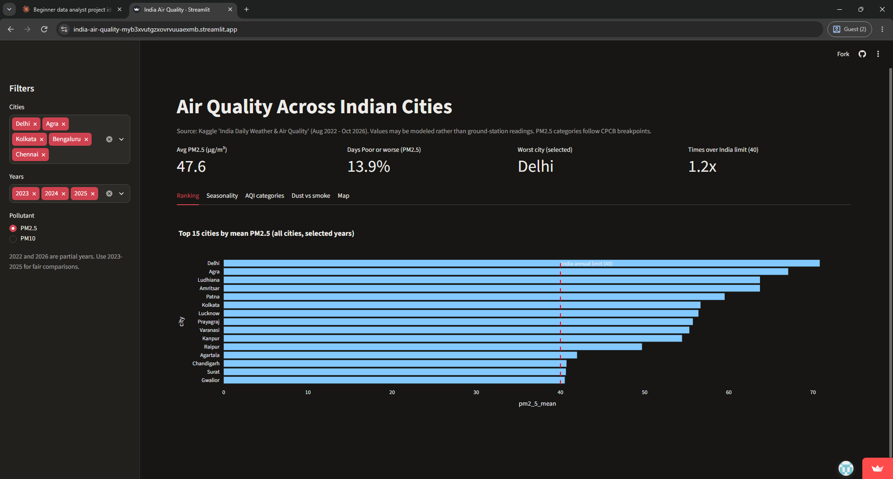
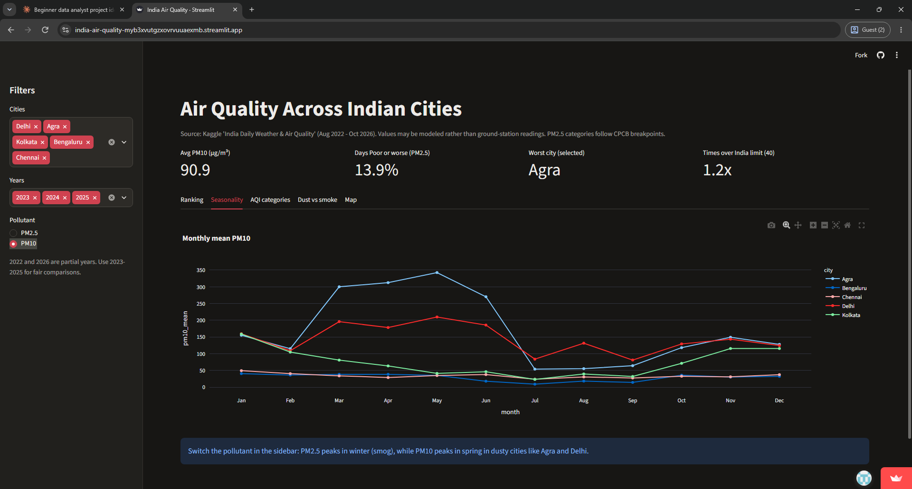
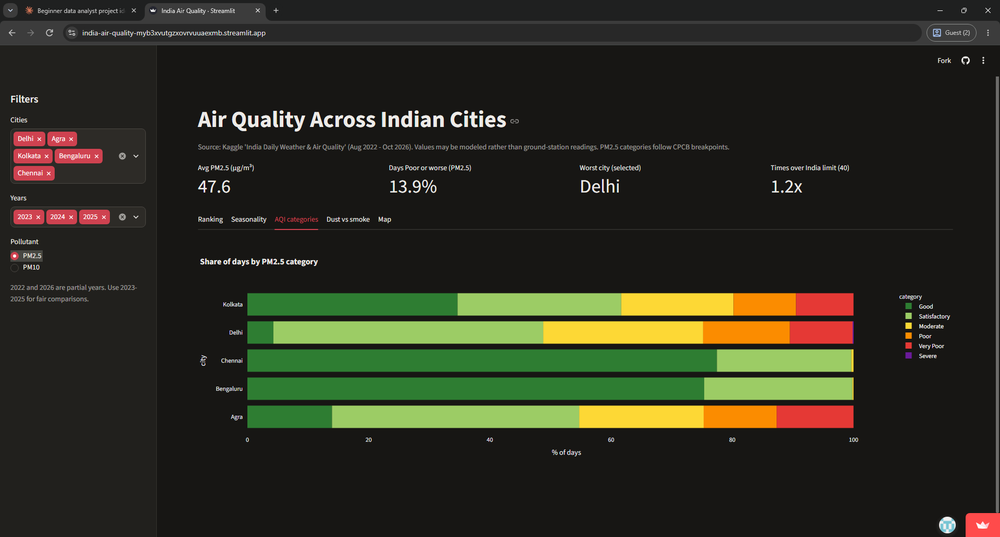

# india-air-quality
# Air Quality Across 50 Indian Cities

**Live dashboard:** https://india-air-quality-myb3xvutgzxovrvuuaexmb.streamlit.app/

An end-to-end analysis of daily PM2.5 and PM10 for 50 Indian cities (Aug 2022 to Oct 2026). It covers data cleaning, exploratory analysis, a test of the "Diwali effect," a weather correlation study, and an interactive Streamlit dashboard.

## Questions
1. Which cities have the worst particulate pollution, and how does that compare with India's standard?
2. How does pollution change through the year?
3. Is pollution in different cities the same kind (smoke vs dust)?
4. Does Delhi's PM2.5 measurably rise around Diwali?
5. Which weather variables are associated with PM2.5?

## Data
- **Source:** Kaggle, *India Daily Weather & Air Quality (Auto-Updated)*.
- **Air quality:** Open-Meteo Air Quality API, which serves the CAMS global atmospheric model (about 45 km resolution). History for India starts August 2022.
- **Weather:** Open-Meteo Historical Weather API (ECMWF IFS and ERA5/ERA5-Land reanalysis, about 9 to 25 km).
- Values are for the model grid cell at each city centre, aggregated to daily means (IST).
- **Size:** 77,400 rows = 50 cities x 1,548 days (2022-08-05 to 2026-10-30).
- **Downloaded:** 2026-11-06. The source updates daily, so a copy is saved in this repo for reproducibility.

## Cleaning and checks
| Check | Result |
|---|---|
| Missing values | None, so no imputation was needed |
| Duplicates / negatives | none found |
| Hours per day | 24 on every row, nothing filtered |
| `india_aqi` | Ozone is the dominant pollutant on 90.2% of days, so PM2.5, PM10 and `india_aqi_pm` were used as the main measures |
| Capped AQI (500) | 229 days, mostly Agra (145) and Delhi (58); `pm2_5_mean` (uncapped) used for averages |
| Complete years | 2023-2025 used for yearly comparisons; 2022 and 2026 are partial |
| PM2.5 categories | CPCB breakpoints (30/60/90/120/250), checked against the CPCB table https://cpcb.gov.in/National-Air-Quality-Index/ 2026-11-07 |

## Key findings

**1. City ranking (mean PM2.5, 2023-2025).** Delhi 70.8 µg/m³, Agra 67.1, Ludhiana and Amritsar 63.7, then Patna, Kolkata, Lucknow, Prayagraj, Varanasi and Kanpur. All exceed India's annual PM2.5 standard of 40 µg/m³, and Delhi is roughly 14 times the WHO 2021 guideline of 5 µg/m³.

**2. Two pollution seasons.** PM2.5 peaks in winter (Nov-Jan). PM10 peaks in spring (Mar-Jun) in dusty cities such as Agra and Delhi.

**3. Agra's extreme days are dust, not smoke.** On its 145 days at the AQI cap, PM10 was the dominant pollutant and the PM2.5/PM10 ratio averaged 0.14. Agra's PM2.5 is nearly identical to Delhi's in every month, so the cap reflects PM10, not worse smog.

**4. Different cities, different pollution.** Jodhpur, Jaipur and Kanpur rank much higher on PM10 than on PM2.5 (dust). Kolkata, Guwahati and Agartala rank higher on PM2.5 (finer particles).

**5. Air quality categories (PM2.5, 2023-2025).** Delhi had 4.3% "Good" days against 34.7% in Kolkata.

## Diwali analysis (Delhi, 2022-2025)
Diwali dates used: 24 Oct 2022, 12 Nov 2023, 31 Oct 2024, 20 Oct 2025.

| Year | Week before | Days +4 to +7 | Change |
|---|---|---|---|
| 2022 | 111.6 | 177.4 | +59% |
| 2023 | 89.9 | 105.4 | +17% |
| 2024 | 78.9 | 135.8 | +72% |
| 2025 | 69.3 | 91.8 | +32% |

PM2.5 (µg/m³) was higher after Diwali in all four years. But two tests suggest this is not specific to Diwali:
- **Control windows** shifted 20 to 50 days earlier changed by -64% to +74%.
- **Percentile test:** compared with every before/after window from 1 Oct to 15 Dec, Diwali ranked only between the 66th and 82nd percentile.

**Conclusion:** the data does not show that Diwali itself drives the increase. The rise cannot be separated from the normal October-December build-up (stubble burning, cooling, weather). There was also no spike on Diwali day itself, which a 45 km model with daily means probably could not capture anyway.

## Weather and PM2.5
Weather was merged with air quality on city and date (77,400 rows). Spearman correlations were used because rainfall and pollution are skewed.

| Weather variable | All cities | Seasonal cycle removed | Delhi winter (n=481) |
|---|---|---|---|
| Wind speed (daily max) | -0.31 | -0.23 | -0.58 |
| Rainfall | -0.45 | -0.15 | 0.03 |
| Humidity | -0.28 | -0.05 | +0.49 |
| Temperature | -0.09 | +0.06 | -0.20 |
| Solar radiation | -0.11 | +0.10 | -0.44 |

"Seasonal cycle removed" subtracts each city's monthly average from every variable before correlating, so it measures day-to-day relationships.

- **Wind is the most consistent correlate of PM2.5.** It stays at -0.23 after removing the seasonal cycle and reaches -0.58 in Delhi's winter, consistent with stagnant air trapping pollution.
- **Much of the rain relationship is seasonal.** It falls from -0.45 to -0.15 once monthly averages are removed. Outside the monsoon, rain days averaged 26.4 µg/m³ against 45.1 on dry days across all cities, but 71.1 against 84.4 in Delhi.
- **Humidity, temperature and radiation mostly track the seasons.** Their day-to-day links are weak.
- **Monsoon temperature check:** across all cities, temperature and PM2.5 correlate at +0.57 within the monsoon, but about half of that reflects differences between cities (hot, dry northern cities versus cool, wet coastal and hill cities). Within each city the correlation falls to +0.26 (per-city median +0.31, range -0.17 to +0.55). Warmer monsoon days are modestly associated with higher PM2.5, and the cause is not identified in this dataset.

## Dashboard
Streamlit app with five tabs (ranking, seasonality, PM2.5 category shares, dust vs smoke scatter, city map) and filters for city, year and pollutant.





## Limitations
- Data come from a **model (CAMS), not ground monitors**. A 45 km grid cell and daily averaging can understate local, short-lived peaks (such as firecrackers) and may differ from CPCB station readings.
- Recent values are provisional and are revised daily by the source.
- Agra's very high PM10 values are model estimates and may overstate dust spikes.
- The Diwali analysis covers one city and four years. The comparison windows overlap and share a seasonal trend, so the percentiles are a rough guide, not a formal significance test.
- Weather correlations are associations, not causes. Wind is the daily maximum, not the mean. Weather and air quality are both model outputs, so some relationships may reflect how the models are built.
- Pooling all 50 cities mixes between-city differences with day-to-day effects, so the seasonality-removed and within-city figures are more reliable than the raw all-city ones.
- The Delhi winter sample (Nov-Feb) spans 2022-2026, including partial years.
- City coordinates in the dashboard are approximate city centres.
- Results describe model estimates, not official air quality measurements.

## Tools
Python (pandas, NumPy, matplotlib, seaborn, plotly), Kaggle Notebooks, Streamlit Community Cloud, GitHub.

## Repo structure
```
app.py
requirements.txt
air_quality_dashboard.csv
notebooks/       cleaning, EDA, Diwali, weather correlation
screenshots/
```

## Run locally
```
pip install -r requirements.txt
streamlit run app.py
```

## Author
Ayti Saketh Siva Pavan & Kinthali Padmasri 
